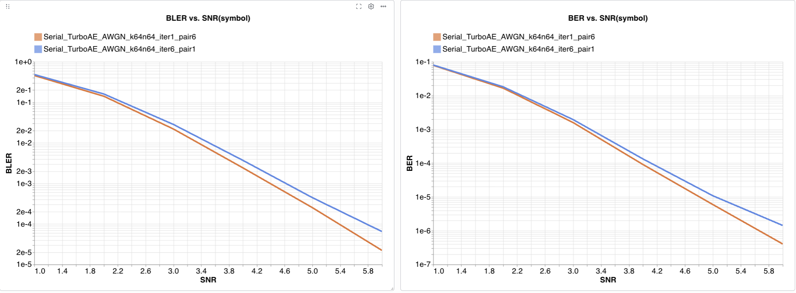
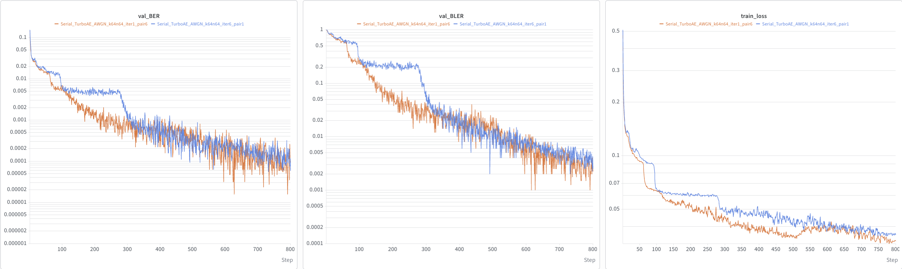

# Serial Turbo Autoencoder over AWGN

[](https://www.python.org/) [](https://pytorch.org/) [](https://wandb.ai/) [](LICENSE)

A PyTorch reproduction of the serial turbo autoencoder (TurboAE) on the AWGN channel from

> **Serial vs. Parallel Turbo-Autoencoders and Accelerated Training for Learned Channel Codes**<br>
> Jannis Clausius, Sebastian Dörner, Sebastian Cammerer, Stephan ten Brink.<br>
> *11th International Symposium on Topics in Coding (ISTC)*, 2021. doi: [10.1109/ISTC49272.2021.9594130](https://doi.org/10.1109/ISTC49272.2021.9594130)

## Contents

- [Serial Turbo Autoencoder over AWGN](#serial-turbo-autoencoder-over-awgn)
  - [Contents](#contents)
  - [1. Overview](#1-overview)
    - [Two decoder variants](#two-decoder-variants)
    - [Results](#results)
  - [2. Installation](#2-installation)
  - [3. Repository Structure](#3-repository-structure)
  - [4. Evaluating the Pretrained Models](#4-evaluating-the-pretrained-models)
  - [5. Training from Scratch](#5-training-from-scratch)
    - [5.1 Running](#51-running)
    - [5.2 Outputs](#52-outputs)
    - [5.3 Configuration reference](#53-configuration-reference)
  - [6. License](#6-license)

## 1. Overview

The serial TurboAE replaces the component encoders and decoders of a serially concatenated turbo code with 1-D CNNs and trains them end to end (Figs. 3 and 4 of the paper):

- **Encoder.** An outer CNN maps $k$ bits to $F_c$ feature streams, which are binarized by a straight-through estimator, interleaved, and mapped by an inner CNN to $k$ complex symbols with unit average energy.
- **Decoder.** An inner CNN, which sees the channel output, and an outer CNN exchange extrinsic information through the (de)interleaver over several iterations. A final CNN outputs the bit estimates.

**Setting.** $k = 64$ information bits, $n = 128$ real (64 complex) channel uses, rate $r = 1/2$, $F_c = F = 10$, 6 decoder iterations. One bit is sent per complex symbol, so the reported SNR is both $E_s/N_0$ and $E_b/N_0$.

### Two decoder variants

Both variants use the same encoder. They differ in how the 6 decoder iterations are parameterized:

| Variant | `num_iteration` | `num_of_pair` | Decoder parameters | Interleaver seed | Checkpoint |
| --- | ---: | ---: | ---: | ---: | --- |
| Weight-shared | 6 | 1 | 0.66 M | 6 | [iter6_pair1](trained_models/Turbo_AutoEncoder_k64n64_iter6_pair1_20261027_10_51_27/) |
| Unrolled | 1 | 6 | 2.73 M | 15 | [iter1_pair6](trained_models/Turbo_AutoEncoder_k64n64_iter1_pair6_20261027_23_37_00/) |

- **Weight-shared:** one inner/outer CNN pair is reused for all 6 iterations, as in Fig. 4 of the paper.
- **Unrolled:** 6 pairs with separate weights, each run once.

### Results

The training loss (BER/BLER validation) does not appear to stop decreasing, so a bit more improvement is expected if you fine-tune them.






**Not included:** the parallel TurboAE and its Gaussian pre-training (Sec. IV), and the classical reference curves (LTE turbo, LDPC, normal approximation).

## 2. Installation

**Requirements**

- Python 3.12 or newer
- A CUDA-capable NVIDIA GPU, strongly recommended. Everything also runs on the CPU, but slowly.
- A free [Weights & Biases](https://wandb.ai/) account. Every run is logged to W&B (see the note in step 4).

**1. Clone the repository.** Both checkpoints (about 17 MB in total) are part of the repository.

```bash
git clone https://github.com/chenbin234/Serial-vs.-Parallel-Turbo-Autoencoders-under-AWGN.git
cd Serial-vs.-Parallel-Turbo-Autoencoders-under-AWGN
```

**2. Create the environment** with [uv](https://docs.astral.sh/uv/), which installs the exact versions pinned in [uv.lock](uv.lock):

```bash
curl -LsSf https://astral.sh/uv/install.sh | sh  # if uv is not installed yet
uv sync                                          # add --no-dev to skip the development tools
source .venv/bin/activate
```

**3. Check the installation.**

```bash
python -c "import torch; print('torch', torch.__version__, '| CUDA available:', torch.cuda.is_available())"
```

**4. Log in to Weights & Biases.**

```bash
wandb login
```

> [!NOTE]
> [src/train/train_turbo_ae.py](src/train/train_turbo_ae.py) starts its W&B run with `mode="online"`, which takes precedence over the `WANDB_MODE` environment variable.

## 3. Repository Structure

```text
.
├── src/
│   ├── models/
│   │   ├── serial_turbo_autoencoder.py    # Serial TurboAE: Encoder, Decoder, end-to-end Turbo_AutoEncoder
│   │   └── components/
│   │       └── STE.py                     # Straight-through estimator for the binarization
│   ├── channel/
│   │   └── AWGN_Channel.py                # Complex AWGN channel, SNR given as Es/N0
│   ├── train/
│   │   ├── train_turbo_ae.py              # Entry point and TurboAEConfig (all hyperparameters)
│   │   ├── trainer.py                     # Alternating encoder/decoder training, validation, checkpointing
│   │   └── utils.py                       # Losses, DDP setup, seeding
│   ├── inference/
│   │   └── inference_turboae.py           # Monte Carlo BER / BLER evaluation
│   └── features/
│       └── build_pytorch_dataset.py       # InfobitDataset: random information bits
├── trained_models/                        # Pretrained checkpoints (see the table above)
├── pyproject.toml                         # Package metadata and dependencies
├── uv.lock                                # Locked dependency versions
└── LICENSE
```

## 4. Evaluating the Pretrained Models

[src/train/train_turbo_ae.py](src/train/train_turbo_ae.py) is the single entry point for training and evaluation. All settings are fields of the `TurboAEConfig` dataclass at the top of that file; change a setting by editing its default value. Run every command from the repository root as a module (`python -m src...`), because the code imports the `src` package.

**Weight-shared model.** The defaults already evaluate it:

```python
# src/train/train_turbo_ae.py, inside TurboAEConfig
pretrained: str | None = "./trained_models/Turbo_AutoEncoder_k64n64_iter6_pair1_20261027_10_51_27/Turbo_AutoEncoder_20261027_10_51_27_epoch800.pth"
is_inference: bool = True  # skip training, only evaluate `pretrained`
num_iteration: int = 6
test_snr_low: float = 1  # dB
test_snr_high: float = 6  # dB
test_snr_interval: float = 1.0  # dB
test_data_samples: int = 10_000_000  # packets per SNR point, split across all GPUs
```

```bash
python -m src.train.train_turbo_ae
```

**Unrolled model.** Point `pretrained` to the other checkpoint, set `num_iteration` to 1, and set `num_of_pair` to 6:

```python
pretrained: str | None = "./trained_models/Turbo_AutoEncoder_k64n64_iter1_pair6_20261027_23_37_00/Turbo_AutoEncoder_20261027_23_37_00_epoch800.pth"
num_iteration: int = 1
num_of_pair: int = 6
```

```bash
python -m src.train.train_turbo_ae --p-array-seed 15
```

## 5. Training from Scratch

### 5.1 Running

Set these fields in `TurboAEConfig`, and choose the decoder variant with `num_iteration` and `num_of_pair` as in [Section 4](#4-evaluating-the-pretrained-models):

```python
pretrained: str | None = None  # start from random weights
is_inference: bool = False  # train, then evaluate
num_samples: int = 500  # packets per training pass
batch_size: int = 500  # initial batch size, as in the paper
```

Then start training on one GPU:

```bash
python -m src.train.train_turbo_ae  # optional: --p-array-seed 6 --seed 2
```

or on several GPUs with DistributedDataParallel:

```bash
torchrun --standalone --nproc_per_node=2 -m src.train.train_turbo_ae --use-ddp
```

Each epoch runs `num_train_enc` encoder steps followed by `num_train_dec` decoder steps. When the validation loss has not improved for 50 epochs, the batch size doubles (up to 4000); after that, the learning rate drops by a factor of 10 (down to $10^{-6}$).

### 5.2 Outputs

- **Checkpoints** are written to `trained_models/Turbo_AutoEncoder_<timestamp>/Turbo_AutoEncoder_<timestamp>_epoch<N>.pth` every `save_every` epochs (default 800, i.e., only the final model).
- **W&B** receives, per epoch, the training and validation loss, the validation BER and BLER at 4 dB, the batch size, and the learning rate. After training, it also receives the BER/BLER-versus-SNR tables. The W&B project name is set in `model_pipeline()`; change it to your own project.

### 5.3 Configuration reference

The `TurboAEConfig` fields behind the hyperparameters in Table I of the paper:

| Paper | Field | Setting | Meaning |
| --- | --- | ---: | --- |
| $(k, n)$ | `k` | 64 | Information bits per packet; the encoder emits $k$ complex symbols, so $n = 2k$ real |
| $F_c = F$ | `F` | 10 | Width of the interleaved feature maps |
| $T_\text{enc}$, $T_\text{dec}$ | `num_train_enc`, `num_train_dec` | 100, 500 | Encoder and decoder steps per epoch |
| Decoder iterations | `num_iteration`, `num_of_pair` | 6, 1 | Iterations per inner/outer CNN pair, and number of pairs |
| Batch size | `batch_size`, `num_samples` | 500 | Initial batch size, doubled on plateaus |
| Learning rate | `learning_rate` | 1e-4 | Adam, reduced on plateaus |
| Encoder SNR | `train_enc_snr_low`, `train_enc_snr_high` | 4.0, 4.0 dB | SNR during encoder training |
| Decoder SNR | `train_dec_snr_low`, `train_dec_snr_high` | 0.5, 4.0 dB | SNR range during decoder training |
| – | `epochs` | 800 | Total training epochs |
| – | `loss_function` | BCE | Binary cross-entropy on the bit estimates |
| – | `enforce_qpsk_symbols` | False | `True` binarizes the inner encoder output ("Serial TurboAE Binary" in Fig. 5) |

## 6. License

This project is released under the [MIT License](LICENSE).

Questions and bug reports are welcome on the [issue tracker](https://github.com/chenbin234/Serial-vs.-Parallel-Turbo-Autoencoders-under-AWGN/issues).
